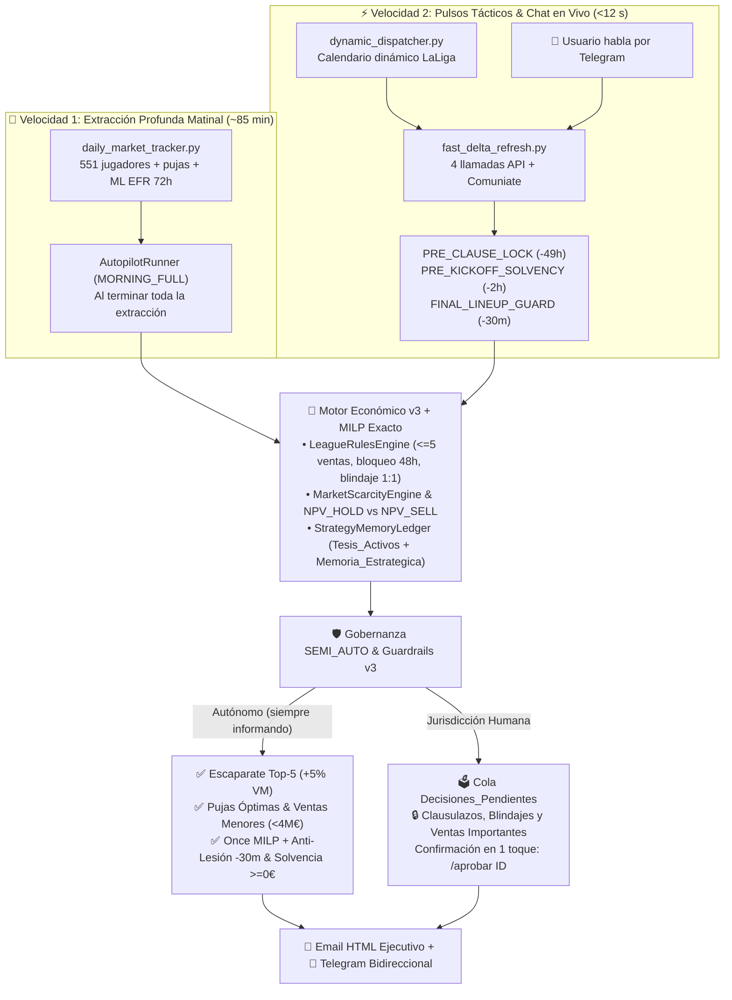

# 🏆 Fantasy Champion v3 — Plataforma Cuantitativa Autónoma & Director Deportivo IA para Biwenger

> **Filosofía Moneyball sin Overfitting:** Maximizar puntos oficiales esperados ($xP$) y creación de patrimonio neto ($NPV$) respetando al **100% las reglas oficiales de tu liga Biwenger** (autodescubiertas automáticamente desde la API), combinando un **Optimizador Exacto MILP** (`scipy.optimize.milp` HiGHS), un **Motor Microeconómico de Escasez y Coste de Reposición**, **Memoria Estratégica Persistente entre Sesiones**, y **Notificaciones Duales (Email HTML + Bot de Telegram Conversacional Bidireccional)**.

---

## ⚡ Inicio Rápido en 90 Segundos (*"Insultantemente Fácil"*)

Cualquier jugador de cualquier liga de Biwenger puede instalar y personalizar su propio Director Deportivo sin tocar ni una sola línea de código:

```bash
# 1. Crear entorno virtual e instalar dependencias
python3 -m venv .venv
.venv/bin/pip install -r requirements.txt

# 2. Lanzar el asistente interactivo (autodescubre tu equipo, tu liga y TODAS sus reglas)
.venv/bin/python -m src.setup_wizard

# 3. Probar tu primer plan estratégico en modo seguro (sin tocar nada en Biwenger)
.venv/bin/python -m src.tools.strategy_engine.autopilot --mode DRY_RUN
```

👉 Consulta la guía paso a paso completa en **[`docs/QUICKSTART.md`](docs/QUICKSTART.md)** y la plantilla documentada en **[`.env.example`](.env.example)**.

---

## 🏗️ Arquitectura v3: Dos Velocidades + Memoria Persistente + Reglas Dinámicas

Biwenger impone un límite estricto de `~200 peticiones API/hora`. **Fantasy Champion v3** resuelve esto combinando **extracciones profundas matinales** con **refrescos delta ultrarrápidos (`<12s`)** adaptados dinámicamente al calendario real de LaLiga (jornadas en viernes, intersemanales en martes/miércoles y parones FIFA):



---

## 🎮 División de Autonomía en Modo `SEMI_AUTO` (Recomendado)

| Tipo de Operación | Quién Ejecuta en `SEMI_AUTO` | Detalle y Protección |
| :--- | :---: | :--- |
| **Escaparate Diario (`<= 5` jugadores)** | 🤖 **Autónomo** | Respeta `marketMaxUserSales` (ej. máx. `5` en venta). Prioriza colateral líquido (`1,25x` deuda) + *flips* sin exponer pilares `FRANCHISE_CORE` ni intocables. |
| **Pujas de Mercado (`place_bid`)** | 🤖 **Autónomo (Notifica)** | Calcula puja óptima con *bid shading* empírico y crédito L–J (`25%`) respaldado exclusivamente por el colateral líquido de tus 5 jugadores en venta. |
| **Ventas Menores / *Flips* (`< 4 M€`)** | 🤖 **Autónomo (Notifica)** | Aplica paciencia multi-día (`offer_rolls` en `Tesis_Activos`) para rechazar ofertas bajas (`-4%`) cuando faltan días para la jornada y capturar picos `+3%..+5%`. |
| **Once Titular MILP + Guardia `-30 min`** | 🤖 **Autónomo (Notifica)** | Alinea el mejor XI multiposición legal por la mañana y vuelve a verificar lesionados de última hora 30 min antes del primer partido. |
| **Rescate de Solvencia Pre-Jornada** | 🤖 **Autónomo (Emergencia)** | Si a falta de `<2h` para empezar la jornada sigues en negativo, liquida el mínimo coste en $xP$ para garantizar **`saldo >= 0 €` (`0` roscos)**. |
| **Clausulazos y Blindajes (`1:1`)** | 👤 **Solo Tú (`/aprobar`)** | Bloqueados automáticamente dentro de la ventana oficial pre-jornada (ej. `48h`) y durante la jornada. El bot calcula el ROI y te pide `/aprobar CL-XXXX`. |
| **Ventas Importantes (`>= 4 M€` o Pilares)** | 👤 **Solo Tú (`/aprobar`)** | Evalúa `NPV_HOLD` vs `NPV_SELL` a 6 jornadas con coste real de reposición y parones FIFA (evitando malvender estrellas irreemplazables por lesiones cortas). |

---

## 💬 Bot de Telegram Bidireccional + Email HTML Matinal

Cada mañana (al finalizar la extracción profunda y el ajuste `MORNING_FULL`), recibes un **Informe Ejecutivo HTML por Email** y un **resumen interactivo en Telegram**. Además, puedes hablarle en español natural en cualquier momento (`"¿Ves algún delantero interesante?"`, `"Si ficho por 9M cómo quedo para el viernes?"`) o usar comandos rápidos:

- `/estado` — Saldo real al segundo, deuda, colateral en venta, fase de jornada y cuenta atrás de cláusulas.
- `/once` — Once titular MILP óptimo actualizado con partes médicos en vivo.
- `/plan` — Recalcula el plan completo del día en `<12 segundos`.
- `/tesis` — Muestra la memoria persistente (`Tesis_Activos`: rol de cada jugador, `NPV_HOLD` vs `NPV_SELL`, coste de reposición y días esperando mejor oferta).
- `/pendientes` · `/aprobar <ID>` · `/rechazar <ID>` — Gestiona clausulazos, blindajes y ventas importantes desde el móvil.
- `/intocable <jugador>` · `/transferible <jugador>` — Actualiza directivas permanentes al instante.

Modos de despliegue de Telegram:
1. **Local / VPS en tiempo real (`<3s`):** `.venv/bin/python -m src.tools.notifications.telegram_bot --listen`
2. **100% Gratis Serverless (GitHub Actions + Cloudflare Worker opcional):** `.github/workflows/telegram_responder.yml` + `deploy/cloudflare_telegram_webhook.js`.

---

## ⚙️ Variables Principales de Personalización (`.env`)

| Variable | Obligatoria | Descripción |
| :--- | :---: | :--- |
| `BIWENGER_EMAIL` / `BIWENGER_PASSWORD` | ✅ | Credenciales de tu cuenta Biwenger (autodescubren liga, equipo y reglas). |
| `AUTOPILOT_MODE` | ✅ | `DRY_RUN` (simulación), `SEMI_AUTO` (recomendado) o `FULL_AUTO`. |
| `IMPORTANT_SALE_MIN_EUR` | ❌ | Umbral en € a partir del cual una venta requiere tu `/aprobar` en `SEMI_AUTO` (defecto: `4000000`). |
| `GEMINI_API_KEY` / `OPENROUTER_API_KEY` | ❌ | Motor LLM para informes y chat (el núcleo matemático MILP funciona incluso con `0` tokens). |
| `GMAIL_ADDRESS` / `GMAIL_PASSWORD` / `NOTIFY_EMAIL_TO` | ❌ | Envío automático del informe matinal HTML por correo (App Password de Gmail). |
| `TELEGRAM_BOT_TOKEN` / `TELEGRAM_CHAT_ID` | ❌ | Notificaciones instantáneas y chat bidireccional con tu Director Deportivo. |
| `OVERRIDE_MARKET_MAX_USER_SALES` / `OVERRIDE_CLAUSE_DISABLED_HOURS` / `OVERRIDE_CREDIT_LIMIT_RATIO` | ❌ | Sobrescrituras manuales opcionales si quieres simular reglas distintas a las de la API. |

---

## 📊 Backtesting Causal Honesto (94 Días) y Suite Visual

El repositorio incluye un simulador histórico sin fuga temporal (`StrictCausalDataView`) y con **paridad exacta de reglas oficiales** (`<= 5` jugadores en venta simultáneos, bloqueo de cláusulas `48h` antes y durante la jornada, blindajes `1:1`, inmunidad de `5` días, validación *Out-of-Time* Abundancia Ago–Sep vs Escasez Sep–Nov y `20` semillas Monte Carlo):

| Estrategia (Liga Real 15 Mánagers, `01-Ago` → `02-Nov`) | Puntos J1–J10 | +J11 Vivo | Total J1–J11 | Rank | Patrimonio Neto | Trading Alpha | Jornadas `<0€` |
| :--- | :---: | :---: | :---: | :---: | :---: | :---: | :---: |
| `0_Real_Manager` (Mánager Real Observado) | `387.0` | `+42.0` | `429.0` | `#10/15` | `58.15 M€` | `-4.34 M€` | `0` |
| `2_Legacy_v2_HonestRules` (Motor v2 bajo reglas reales `<=5` ventas/48h) | `398.0 ± 53.7` | `+43.8` | `441.8` | `#9/15` | `63.17 M€` | `+0.79 M€` | `3` |
| `3_v3_Quant_No_Clauses` (Champion v3 puro mercado sin cláusulas) | `492.0` | `+60.0` | `552.0` | `#2/15` | `84.26 M€` | `+19.21 M€` | `0` |
| **`5_Champion_v3_MC20` (Champion v3 Media 20 Semillas)** | **`475.3 ± 29.2`** | **`+55.0`** | **`530.3`** | **`#3/15` (`75%` Podio / `10%` #1)** | **`85.57 M€`** | **`+19.82 M€`** | **`0` (`0/220`)** |

```bash
# 1. Diagnóstico rápido de configuración y reglas de tu liga
.venv/bin/python -m src.setup_wizard --check

# 2. Suite completa de tests unitarios (Arquitectura v3 + Integridad Causal MILP)
.venv/bin/python test/08_v3_architecture/test_v3_suite.py -v
.venv/bin/python test/07_strategy_backtest/test_backtester_integrity.py -v

# 3. Ejecutar Backtesting Honesto de 94 Días (20 semillas Monte Carlo en paralelo)
.venv/bin/python test/07_strategy_backtest/run_backtest.py --monte-carlo-seeds 20

# 4. Generar los 4 paneles visuales en alta resolución (data/backtest/charts/*.png)
.venv/bin/python -m src.tools.backtester.visual_diagnostics

# 5. Abrir el Cuadro de Mando Ejecutivo en Streamlit
.venv/bin/streamlit run app.py
```

---

## 📁 Estructura del Repositorio

```text
Fantasy Champion v3/
├── .env.example                          # Plantilla documentada multi-usuario ("insultantemente fácil")
├── app.py                                # Cuadro de mando Streamlit (Finanzas, Tesis, Autopilot, Backtest Visual)
├── docs/QUICKSTART.md                    # Guía paso a paso para cualquier usuario y liga
├── deploy/cloudflare_telegram_webhook.js # Webhook serverless opcional para respuesta inmediata en Telegram
├── .github/workflows/                    # Orquestación CI: tracker matinal, pulsos tácticos y bot Telegram
├── src/
│   ├── config.py                         # Autodescubrimiento de identidad y configuración centralizada
│   ├── setup_wizard.py                   # Asistente interactivo de instalación y diagnóstico (--check)
│   ├── llm_endpoints/                    # TieredLLMRouter (Gemini 0€ + OpenRouter failover)
│   └── tools/
│       ├── data_extraction/              # daily_market_tracker.py, fast_delta_refresh.py (<12s), sync_local.py
│       ├── strategy_engine/              # league_rules.py, replacement_cost.py, strategy_memory.py,
│       │                                 # xp_model.py, clause_sniper.py, portfolio_optimizer.py, autopilot.py
│       ├── notifications/                # notifier.py (Email HTML + Telegram) & telegram_bot.py (chat 2 vías)
│       ├── scheduler/                    # dynamic_dispatcher.py (ventanas dinámicas según calendario LaLiga)
│       ├── coach_analytic/               # guardrails.py (protección dura de intocables, <=5 ventas, bloqueo 48h)
│       ├── biwenger_actions/             # market_actions.py (sync_market_listings, control cuota API, JSONL audit)
│       └── backtester/                   # causal_clock.py, market_env.py, benchmark_suite.py, visual_diagnostics.py
└── test/
    ├── 07_strategy_backtest/             # Tests de integridad causal + runner CLI multi-semilla
    └── 08_v3_architecture/               # Suite de verificación v3 (calendario dinámico, NPV sin overfitting, 0 hardcoding)
```
