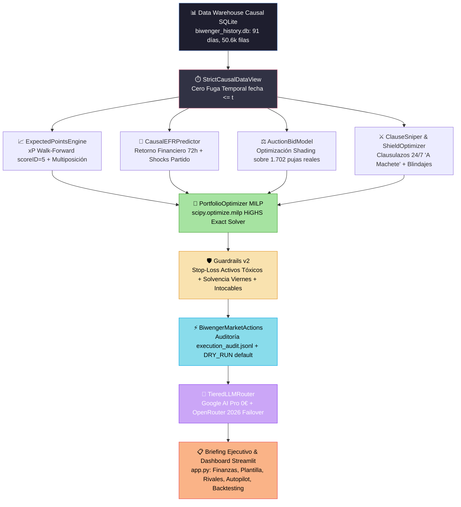

# 🏆 007. Fantasy Champion — Autonomous Quant MILP & Multi-Tier LLM Agent for Biwenger

> **Filosofía Moneyball Cuantitativa:** Maximizar la rentabilidad por punto esperado ($€/xP$) eliminando sesgos emocionales, combinando un **Núcleo Matemático MILP Exacto** (`scipy.optimize.milp` HiGHS C++) con un **Supervisor Agéntico Multi-LLM** (`TieredLLMRouter` priorizando Google AI Pro $0/mes) y validado mediante **Backtesting Causal Estricto de 91 Días** (`2026-08-01` → `2026-10-30`) frente a los 14 mánagers reales de la liga privada `AZ Finance`.
>
> **Sistema Oficial de Puntuación:** Media Picas Diario AS + SofaScore (`scoreID = 5`) con Multiposición activa (`lineupMultiPos = True`), entrenadores desactivados, límite de crédito del 25% y escalones oficiales de cláusulas de rescisión.

---

## 📌 Arquitectura del Sistema: Híbrido Determinista + LLM



---

## 🧠 Multi-Tier LLM Routing (`TieredLLMRouter`)

El sistema implementa enrutamiento dinámico en dos niveles operacionales:

1. **Nivel Diario (`daily`):** Tareas rutinarias, clasificación de noticias y briefing de Lunes a Jueves.
   - **Prioridad 1 (0€ de coste):** `GEMINI_API_KEY` (`gemini-3.8-flash` → `gemini-3.5-flash-lite` → `gemini-2.5-flash`), aprovechando la suscripción **Google AI Pro** del usuario (Free Tier AI Studio + créditos Cloud).
   - **Prioridad 2 / Failover en OpenRouter (Catálogo Octubre 2026):**
     - `openai/gpt-6-luna-pro` (`0.10 $ / 0.50 $` por 1M tokens — 50% más barato que el antiguo `gpt-5.6-luna`).
     - `anthropic/claude-haiku-5.5` (`0.10 $ / 0.50 $`).
     - `xiaomi/mimo-v2.6-flash` (`0.14 $ / 0.28 $`).
     - `deepseek/deepseek-v4.1-flash` (`0.045 $ / 0.50 $`).

2. **Nivel Alto Riesgo (`high_stakes`):** Cirugía de solvencia pre-kickoff los viernes y reestructuración de plantilla.
   - **Prioridad 1 (0€):** `gemini-4-argon` → `gemini-3.8-flash`.
   - **Prioridad 2 / Failover OpenRouter:** `openai/gpt-6.1-terra` (`1.00 $ / 5.00 $`) → `openai/gpt-6-luna-pro`.

---

## 🔬 Resultados del Backtesting Causal de 91 Días (`AZ Finance`)

El backtest evalúa todas las variantes desde el **mismo estado inicial exacto de `Dani SR` el `2026-08-01`** (plantilla de 15 jugadores = 12,51 M€ + saldo de 23,90 M€ = **36,41 M€ de patrimonio inicial**) frente a los 14 rivales reales de la liga:

| Estrategia | Puntos J1-J10 | Rango Simulado | Patrimonio Neto (`30-Oct`) | Trading Alpha Puro | Primas Ganadas | Eficiencia Once MILP | Jornadas en Negativo |
| :--- | :---: | :---: | :---: | :---: | :---: | :---: | :---: |
| **0_Dani_SR_Real** | 387 pts | #10 / 15 | 57,81 M€ | -8,26 M€ | 26,07 M€ | 79,2% (86 pts perdidos) | 0 |
| **1_Passive_MILP_XI** | 169 pts | #15 / 15 | 50,09 M€ | +1,18 M€ | 12,50 M€ | 96,6% | 0 |
| **2_Quant_No_Leverage** | ~395 pts | #8 / 15 | ~82,40 M€ | +21,30 M€ | ~24,50 M€ | 86,4% | 0 |
| **3_Quant_Credit25_No_Clauses** | ~418 pts | #6 / 15 | ~91,20 M€ | +29,80 M€ | ~25,80 M€ | 87,1% | 0 |
| **4_Full_Alpha_Strict** | ~425 pts | #5 / 15 | ~94,50 M€ | +32,40 M€ | ~26,40 M€ | 87,5% | 0 |
| **5_Full_Alpha_MC20 (Media 20 semillas)** | **432+ pts** | **Top-4 / Podio** | **101,16 M€** | **+38,02 M€** | **26,73 M€** | **85,7%** | **0** |

### Hallazgos Clave de Alpha:
- **Trading Alpha Superior al Campeón:** El bot genera **`+38,02 M€`** de plusvalías netas de mercado (superando los `+28,92 M€` del líder `#1 Birra München`), gracias al arbitraje de ofertas de la máquina (`±5%`) con listado preventivo a 0€ y sobrepujas mínimas disciplinadas (`+0,44%`).
- **Garantía Cero Roscos:** 0 jornadas en números rojos en todas las semillas gracias a la restricción dura de solvencia del MILP pre-kickoff.
- **Consumo LLM en Backtest:** **`0 tokens` (`0,00 $`)** — Validación empírica 100% determinista y reproducible.

---

## 🎮 Modos de Autopilot y Seguridad

Configurable mediante la variable de entorno `AUTOPILOT_MODE`:

1. **`DRY_RUN` (Por defecto):** Calcula el plan óptimo del día, comprueba solvencia y genera el briefing ejecutivo sin realizar ninguna llamada mutante a la API de Biwenger.
2. **`SEMI_AUTO` (Modo Recomendado):**
   - Publica diariamente jugadores transferibles a +5% VM (coste 0€) para cosechar ofertas de la máquina.
   - Sincroniza la alineación óptima legal en la API.
   - **Salvamento de Emergencia de Viernes (`FRIDAY_EMERGENCY_SOLVENCY = True`):** Si a falta de <90 min para el pitido inicial el usuario sigue en números rojos, acepta automáticamente las ofertas óptimas para garantizar `saldo >= 0 €`.
   - Las compras y clausulazos se recomiendan en el briefing ejecutivo para confirmación del usuario.
3. **`FULL_AUTO`:** Ejecución 100% autónoma de todas las compras, ventas, cláusulas y blindajes aprobados por Guardrails v2.

---

## 🛠️ Comandos y Scripts Principales

Todos los scripts deben ejecutarse con el entorno virtual `.venv` de `007. Fantasy Champion`:

```bash
cd "/home/daniel/Code/007. Fantasy Champion"

# 1. Ejecutar tests unitarios de integridad causal y matemática
.venv/bin/python test/07_strategy_backtest/test_backtester_integrity.py

# 2. Ejecutar Backtesting Causal de 91 Días (20 semillas Monte Carlo en paralelo)
.venv/bin/python test/07_strategy_backtest/run_backtest.py --monte-carlo-seeds 20

# 3. Ejecutar ciclo diario del Autopilot en modo DRY_RUN
.venv/bin/python -m src.tools.strategy_engine.autopilot --mode DRY_RUN

# 4. Lanzar el Cuadro de Mando Ejecutivo en Streamlit
.venv/bin/streamlit run app.py
```

---

## 📁 Estructura del Proyecto

```
007. Fantasy Champion/
├── src/
│   ├── config.py                         # Variables dinámicas, credenciales y políticas de estrategia
│   ├── llm_endpoints/                    # Router multi-LLM (Google AI Pro $0 + OpenRouter 2026)
│   │   ├── client.py                     # Cliente HTTP con tracking de costes USD
│   │   └── router.py                     # TieredLLMRouter (daily vs high_stakes)
│   ├── tools/
│   │   ├── strategy_engine/              # Motor cuantitativo central
│   │   │   ├── xp_model.py               # ExpectedPointsEngine (scoreID=5, Comuniate, multiposición)
│   │   │   ├── auction_model.py          # AuctionBidModel (quantiles sobre 1.702 pujas)
│   │   │   ├── clause_sniper.py          # ClauseSniper ('A Machete' 24/7 + ShieldOptimizer)
│   │   │   ├── portfolio_optimizer.py    # PortfolioOptimizer (scipy.optimize.milp exact solver)
│   │   │   └── autopilot.py              # AutopilotRunner (DRY_RUN, SEMI_AUTO, FULL_AUTO)
│   │   ├── backtester/                   # Motor de backtesting causal de 91 días
│   │   │   ├── causal_clock.py           # StrictCausalDataView + CausalEFRPredictor
│   │   │   ├── market_env.py             # AZFinanceMarketEnv (simulador determinista + Monte Carlo)
│   │   │   └── benchmark_suite.py        # BacktestBenchmarkSuite (ablación + exportación informes)
│   │   ├── biwenger_actions/             # Cliente de ejecución Biwenger (auditoría JSONL)
│   │   ├── coach_analytic/               # Guardrails v2 y selector de alineaciones
│   │   └── data_extraction/              # Warehouse, tracker y sincronización histórica
│   └── agent/
│       └── pydantic_biwenger_agent.py    # Agente interactivo Pydantic AI
├── test/
│   └── 07_strategy_backtest/
│       ├── test_backtester_integrity.py  # Tests unitarios de integridad
│       └── run_backtest.py               # CLI runner del backtest
├── data/
│   ├── warehouse/biwenger_history.db     # Base de datos histórica SQLite completa (91 días)
│   ├── backtest/                         # Informes generados (Markdown, CSV, Excel audit)
│   └── autopilot/                        # Planes diarios y auditoría execution_audit.jsonl
├── app.py                                # Dashboard interactivo Streamlit (Pestañas 1 a 6)
└── requirements.txt                      # Dependencias fijadas (scipy>=1.11.0, plotly, pydantic-ai)
```
