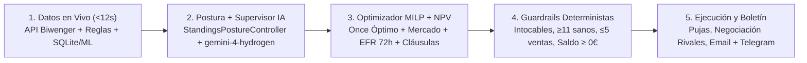

# 🧠 Estrategias, Inteligencia Adaptativa y Torneo Cuantitativo (`Fantasy Champion`)

Este documento explica en profundidad **cómo toma decisiones el bot**, qué hace exactamente la estrategia ganadora activa (**`LIQUIDITY_VULTURE_PRO`**), qué otros arquetipos existen, cómo se ajusta según tu posición en la clasificación, cuándo interviene **`gemini-4-hydrogen`** y cómo negocia con los rivales sin poner en riesgo tu saldo.

---

## 🔄 1. Cómo Piensa el Bot Cada Día (Pipeline en 5 Capas)

1. **Autodescubrimiento y refresco en vivo (`FastDeltaRefresh` + `LeagueRulesEngine`)**: lee automáticamente las reglas oficiales de tu liga (crédito máximo permitido, límite de jugadores en venta, cierre pre-jornada y escalones de cláusula), tu saldo real, tus pujas salientes y las ofertas/contraofertas activas.
2. **Postura por Clasificación + Meta-Supervisión IA**: ajusta agresividad y presupuesto según si vas líder, en pelea por el podio o remontando desde atrás, y consulta a **`gemini-4-hydrogen`** solo cuando ocurre un evento relevante (cierre de jornada, lesión de un pilar, parón o ventana pre-cláusulas).
3. **Optimización Matemática Exacta (`PortfolioOptimizer` + `MILP`)**: calcula simultáneamente tu mejor XI legal, qué jugadores de tu plantilla aportan menos que su coste de reemplazo (`NPV_HOLD` vs `NPV_SELL`), qué pujas maximizan subida de valor a 72h (`EFR`) y puntos esperados (`xP`), y qué cláusulas son rentables.
4. **Filtros de Seguridad (`guardrails.py`)**: impiden matemáticamente cualquier decisión catastrófica antes de tocar la API.
5. **Ejecución, Limpieza de Negociaciones y Boletín**: limpia contraofertas caras y pujas bloqueadas para liberar `available_max_bid`, ejecuta según el modo (`FULL_AUTO` / `SEMI_AUTO` / `DRY_RUN`) y envía tu informe por Email HTML + Telegram.

---

## 🏆 2. Estrategia Activa por Defecto: `LIQUIDITY_VULTURE_PRO`

> **Nombre completo:** *Buitre de Liquidez Pro (`EFR + Gangas`)*  
> **Definición en código:** [`src/tools/strategy_engine/archetypes.py`](../src/tools/strategy_engine/archetypes.py) · **Modo activo en workflows:** `.env` / GitHub Actions (`ACTIVE_ARCHETYPE=LIQUIDITY_VULTURE_PRO`)

### ¿Cuál es la idea en palabras sencillas?
En lugar de inmovilizar todo el dinero en un solo cromo caro desde el principio o sobrepujar a ciegas, **`LIQUIDITY_VULTURE_PRO` hace crecer tu dinero más rápido que el resto de la liga** y convierte esa ventaja financiera en puntos:

1. **Rotación rápida de capital (`+EFR` 72h):** busca hasta **`6` pujas simultáneas** al día en gangas con fuerte subida esperada en las próximas 72 horas (`efr_weight = 1.35`, umbral mínimo `min_efr_trigger = 32.000 €`, agresividad especulativa `spec_bid_aggression = 1.12`).
2. **Cero apego a cromos estancados (`decay` estricto a los 3 días):** si una apuesta especulativa deja de rendir financieramente pasados **`3 días`** (`speculative_hold_days_max = 3`), aplica una penalización diaria de **`115.000 €/día`** (`hold_decay_penalty_eur`) para rotar ese capital hacia una oportunidad mejor.
3. **Clausulazos solo con descuento real (`VALUE_COMPOUND_VORP`):** exige una relación precio/valor estricta (**tope de `1.95x`** sobre su ratio de cláusula), media mínima **`4.4 pts`** y mejora real mínima sobre tu XI titular de **`+0.55 xP`** (`clause_min_delta_xp`), priorizando timing **`HYBRID`**.
4. **Plantilla amplia para capturar subidas (`18` jugadores):** mantiene margen de maniobra entre jornadas (`clause_cash_reserve_pct = 0.60`, `credit_utilization_aggression = 1.10`) y protege tus pilares estructurales (`protect_pillars_absolute = True`, `shield_rival_threat_pct = 0.14`).

---

## 🧪 3. Resultados del Torneo Cuantitativo Masivo (`798` Simulaciones)

Para no elegir la estrategia por intuición, se ejecutó un torneo en **3 etapas** (`M1` base, `M2` estrés de regímenes extremos y `M3` validación fuera de muestra *Cross-Regime Holdout*) sobre **`105` días causales (`J1..J12`)** con **cero fugas al futuro** (*zero lookahead*).

### Podio General de Pareto (`M3`)

| Puesto | Estrategia | Score M3 | Desempeño destacado verificado | Insolvencias (M1+M2+M3) |
| :---: | :--- | :---: | :--- | :---: |
| 🥇 **#1** | **`LIQUIDITY_VULTURE_PRO`** *(Activa)* | **`535.37`** | **`464.1 ± 49.5` pts** y **`87.62M €`** de patrimonio en M1 (Campeón Pareto equilibrado) | **`0`** |
| 🥈 **#2** | `VAR_VULTURE_EFR14` *(variante experimental)* | **`531.12`** | Alto compuesto de liquidez en submuestra | **`0`** |
| 🥉 **#3** | `TEMPO_ARB_COMPOUNDER` | **`531.0`** | `443.2` base · `434.6` escasez · `356.9` élite · `101.5` catch-up · `430.7` rival · `97.2` racha | **`0`** |

🔍 **Explora todos los datos y gráficos interactivos:**
- 📊 [**Comparativa Visual Interactiva (`strategy_comparison.html`)**](../data/backtests/strategy_comparison.html) — Gráficos comparativos y evolución por escenario.
- 📑 [**Informe Completo del Torneo (`massive_tournament_report.md`)**](../data/backtests/massive_tournament_report.md) — Tablas íntegras por régimen (`Base`, `Escasez`, `Élite`, `Catch-up`, `Rival`, `Racha`).
- 🏗️ [**Arquitectura de Datos y Simulador Causal (`ARQUITECTURA_DATOS_Y_BACKTESTING.md`)**](ARQUITECTURA_DATOS_Y_BACKTESTING.md) — Cómo se reconstruye la liga desde `2026-08-01` con `0 €` de desviación.

---

## 📚 4. Catálogo Completo de los 11 Arquetipos

Todos los arquetipos están definidos en [`src/tools/strategy_engine/archetypes.py`](../src/tools/strategy_engine/archetypes.py). Puedes cambiar de estrategia ajustando `ACTIVE_ARCHETYPE` en `.env` o en las variables del workflow:

| ID del Arquetipo | Enfoque | Plantilla Obj. | Tope Cláusula | Media Mín. / ΔxP | Política Cláusulas | Timing | Hold Espec. Máx. | Prioridad |
| :--- | :--- | :---: | :---: | :---: | :--- | :--- | :---: | :--- |
| **`LIQUIDITY_VULTURE_PRO`** ⭐ | Capital compuesto rápido + gangas + cláusulas con descuento | `18` | `1.95x` | `4.4` / `+0.55` | `VALUE_COMPOUND_VORP` | `HYBRID` | `3d` | `WEALTH_COMPOUND` |
| **`TEMPO_ARB_COMPOUNDER`** | Rotación ultra-rápida (`140k/d` penalización) para escalar en H2 | `20` | `2.15x` | `4.6` / `+0.60` | `VALUE_COMPOUND_VORP` | `HYBRID` | `2d` | `WEALTH_COMPOUND` |
| **`HYBRID_RANK_PREDATOR`** | Híbrido equilibrado por clasificación + sniping selectivo | `16` | `2.25x` | `4.7` / `+0.65` | `VALUE_COMPOUND_VORP` | `HYBRID` | `3d` | `BALANCED` |
| **`ADAPTIVE_LIFECYCLE`** | Ciclo clásico: trader inicial → depredador VORP → cosecha XI | `15` | `2.20x` | `4.8` / `+0.75` | `COMPETITIVE_VORP` | `HYBRID` | `3d` | `BALANCED` |
| **`QUANT_GALACTIC_CORE_V2`** | Primas fuertes por saltos de calidad en el XI (amortización `9J`) | `14` | `2.45x` | `5.0` / `+0.90` | `COMPETITIVE_VORP` | `PRE_LOCK_SURGICAL` | `2d` | `XI_MAX` |
| **`GALACTICOS_CORE`** | Plantilla ultracorta para ahorrarse cromos medios y cazar top liga | `13` | `2.50x` | `5.4` / `+1.20` | `COMPETITIVE_VORP` | `PRE_LOCK_SURGICAL` | `2d` | `XI_MAX` |
| **`MONEYBALL_QUANT`** | Eficiencia pura puntos / euro sin apego a estrellas sobrevaloradas | `18` | `1.90x` | `4.2` / `+0.50` | `VALUE_COMPOUND_VORP` | `HYBRID` | `4d` | `WEALTH_COMPOUND` |
| **`PREDATOR_ANTILEADER`** | Ataca cláusulas de líderes cuando quedan cortos de margen | `15` | `2.30x` | `4.9` / `+0.60` | `AGGRESSIVE` | `IMMEDIATE` | `3d` | `VORP_SNIPER` |
| **`COMPOUND_BREAK_MASTER`** | Explota parones largos para maximizar patrimonio | `19` | `2.00x` | `4.6` / `+0.70` | `SURGICAL_SCARCITY` | `HYBRID` | `5d` | `WEALTH_COMPOUND` |
| **`REGIME_SENTINEL_SHIELD`** | Defensivo de baja varianza (`400k €` colchón y alto blindaje) | `15` | `2.10x` | `4.8` / `+0.85` | `SURGICAL_SCARCITY` | `PRE_LOCK_SURGICAL` | `3d` | `XI_MAX` |
| **`ASYMMETRIC_CHASER_MAX`** | Remontada agresiva: crédito ampliado y cláusulas inmediatas | `17` | `2.35x` | `4.5` / `+0.50` | `AGGRESSIVE` | `IMMEDIATE` | `3d` | `VORP_SNIPER` |

---

## 🎯 5. Adaptación Automática según Tu Puesto (`StandingsPostureController`)

Cuando `POSTURE_ADAPTATION_ENABLED=true` (por defecto) y `rank_adaptive=True`, el controlador en [`src/tools/strategy_engine/posture_controller.py`](../src/tools/strategy_engine/posture_controller.py) cambia automáticamente el "temperamento" de la estrategia según tu clasificación real:

| Postura | Cuándo se activa | Qué cambia automáticamente en el optimizador |
| :--- | :--- | :--- |
| **`EARLY_SEASON_CALIBRATION`** | Inicio de temporada (`< 2` jornadas disputadas o `< 3` mánagers) | Neutralidad (`1.0x`) para acumular patrimonio y calibrar precios reales sin sesgos. |
| **`PROTECT_LEAD`** | Vas **#1 en la clasificación** | Reduce varianza y sobrepujas (`bid_aggression_mult` hasta `0.89x`, `overbid_cap_mult` hasta `0.84x`), sube el requisito de rentabilidad en cláusulas (`+450k` a `+900k €`), prioriza blindar titulares y cambia cláusulas a `PRE_LOCK_SURGICAL`. |
| **`TACTICAL_PRESS`** | En pelea por el podio / zona alta a distancia alcanzable | Presión quirúrgica (`bid_aggression_mult` `1.01x–1.08x`, `credit_usage_mult` `1.02x–1.11x`) en subastas y cláusulas `HYBRID` de mejora neta. |
| **`ASYMMETRIC_CHASER`** | Desventaja amplia (`>= 65 pts` y `#5+`, mitad baja tras `>= 3J`, o `>= 3.0 pts/jornada` de déficit) | Activa modo remontada: amplía techo de sobrepuja (`1.12x–1.26x`), rebaja el suelo de cláusula (`-450k` a `-1.10M €`), prioriza ofensiva sobre blindaje pasivo y acelera el uso de crédito (`1.08x–1.18x`). |

---

## 🤖 6. Frecuencia Inteligente y Supervisor `Gemini 4 Hydrogen`

El bot usa **`gemini-4-hydrogen`** (con failover configurado en el router a `google/gemini-4-hydrogen`) como meta-supervisor estratégico en [`src/tools/strategy_engine/llm_supervisor.py`](../src/tools/strategy_engine/llm_supervisor.py).

Para no malgastar llamadas ni oscilar caprichosamente en ejecuciones repetidas del mismo día, el supervisor **solo se consulta cuando detecta un cambio de régimen real** (si no, reutiliza su postura cacheada `CACHED_POSTURE` desde `Memoria_Estrategica`):

- **`KEY_INJURY_SHOCK`**: nueva lesión detectada en jugadores clave/titulares.
- **`POST_ROUND_SETTLEMENT`**: tras liquidarse una nueva jornada en la clasificación.
- **`PRE_CLAUSE_LOCK`**: ventana `<= 48h` antes del cierre de cláusulas (y `>= 2 días` desde la última revisión).
- **`INTERNATIONAL_BREAK`**: parón largo (`>= 8 días` hasta el próximo partido y `>= 3 días` desde la última revisión).
- **`PERIODIC_5D_REVIEW`**: revisión rutinaria cada `5 días` como máximo, o bajo demanda (`MANUAL_FORCE`).

Además, sus ajustes numéricos están **estrictamente acotados** (*clamped*) para proteger el modelo matemático MILP:
- `bid_aggression_delta`: `[-0.12, +0.15]`
- `overbid_cap_delta`: `[-0.10, +0.18]`
- `clause_alpha_delta_eur`: `[-1.000.000 €, +1.500.000 €]`
- `speculation_vs_points_tilt`, `shield_aggression_delta`, `credit_aggression_delta`: `[-0.15, +0.15]` cada uno.

---

## 🤝 7. Negociación con Rivales, Crédito Vivo y Clausulazos

Implementado entre [`autopilot.py`](../src/tools/strategy_engine/autopilot.py) y [`fast_delta_refresh.py`](../src/tools/data_extraction/fast_delta_refresh.py), el motor separa estrictamente las pujas propias, las ofertas de compra que recibes y las contraofertas que te mandan los rivales:

1. **Ofertas que un rival te envía por tus jugadores (`incoming_rival_offers`)**:
   - Solo se acepta si tu algoritmo determina que **`NPV_SELL > NPV_HOLD`** (es decir, el dinero + reemplazo rinde más que retenerlo) y en `SEMI_AUTO` cualquier venta importante (`>= 4M €`, o roles `FRANCHISE_CORE` / `STRUCTURAL_STARTER`) queda pendiente de tu **`/aprobar`**.
2. **Contraofertas que te envía un rival tras pujar tú (`incoming_counter_offers`)**:
   - **`SOBREPRECIO_RECHAZAR`** *(si pide `>= +20%` sobre valor de mercado, o `>= +12%` cayendo de precio en 24h, o está no disponible)*: en `MORNING_FULL` / `POST_ROUND_SETTLEMENT` / `PRE_CLAUSE_LOCK`, rechaza automáticamente la contraoferta **y cancela nuestra puja saliente bloqueada** para recuperar ese crédito al instante.
   - **`ACEPTABLE_SI_MEJORA_XI`** *(si `xp_best >= 4.0`, mejora al XI en `>= +0.45 xP`, prima `<= +12%` sobre VM y sin desplome `subida_24h >= -25.000 €`)*: si cabe en plantilla y en el crédito disponible tras limpiar pujas, la ejecuta en `FULL_AUTO` o la encola para `/aprobar` en `SEMI_AUTO`.
3. **Limpieza de pujas estancadas (`>= 48h` sin respuesta)**:
   - Si una puja saliente a un rival lleva `48h+` ignorada bloqueando tu margen real (`available_max_bid`), el bot la cancela automáticamente para devolver ese margen de puja a las oportunidades del día.
4. **Clausulazos y topes de seguridad (`FULL_AUTO`)**:
   - Nunca supera la puja máxima operativa (`available_max_bid`) ni las reglas de bloqueo de cláusulas de tu liga.
   - En `FULL_AUTO`, cada clausulazo autónomo está acotado al **`45%` del patrimonio neto** (`AUTONOMOUS_CLAUSE_MAX_PCT = 0.45`) con un tope duro absoluto de **`25.000.000 €`** (`AUTONOMOUS_CLAUSE_HARD_CAP_EUR`, configurable) y umbral base de referencia `AUTONOMOUS_CLAUSE_MAX_EUR = 6.000.000 €`.

---

## 🛡️ 8. Guardrails Inquebrantables (`guardrails.py`)

Ninguna estrategia ni la IA pueden saltarse estas reglas físicas en [`src/tools/coach_analytic/guardrails.py`](../src/tools/coach_analytic/guardrails.py):
- **Veto absoluto a `/intocable`:** cualquier jugador marcado por ti en Telegram/Sheets queda blindado frente a ventas.
- **Plantilla mínima jugable:** nunca deja la plantilla por debajo de **`11` jugadores sanos** (`MIN_SQUAD_SIZE = 11`).
- **Límite oficial diario de ventas:** respeta el máximo diario de tu liga (ej. `marketMaxUserSales = 5` jugadores).
- **Garantía anti-cero antes del primer partido (`PRE_KICKOFF_SOLVENCY`):** si tu saldo es negativo `2.5h` antes del arranque de la jornada, ejecuta ventas colaterales de menor impacto para cerrar con **`saldo >= 0 €`** y puntuar en la jornada.
